**Sysadmin · Software Engineer · Network Engineer · DevSecOps & Cloud**

**About Me**

- Working across **systems, software, networks, security, and cloud**
- Focused on **DevSecOps** and building secure, automated pipelines
- Deploying and maintaining infrastructure in the cloud
- Building **Elysium Vintage Roleplay**, a classic text-based SA:MP server
- Based in Indonesia

 

**Tech Stack**

**Featured Project**

**Elysium Vintage Roleplay**

**Classic SA:MP Server — Text Based**

A vintage-style roleplay server built on SA:MP, focused on text-based interactions and classic roleplay immersion.

**GitHub Stats**

 

## **Contribution Snake**

**Commit Invaders**

**Brick Breaker**

**Pac-Man Contribution Graph**

### **Connect**

Thanks for stopping by — built with consistency, not shortcuts.

